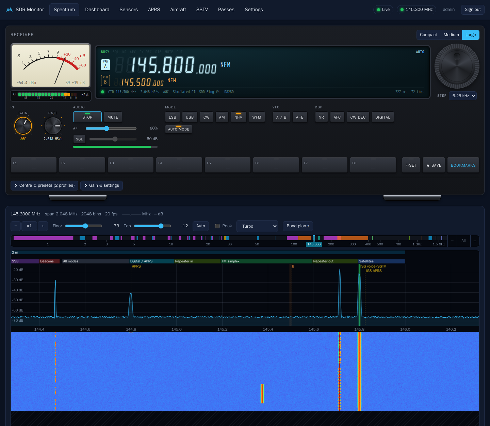
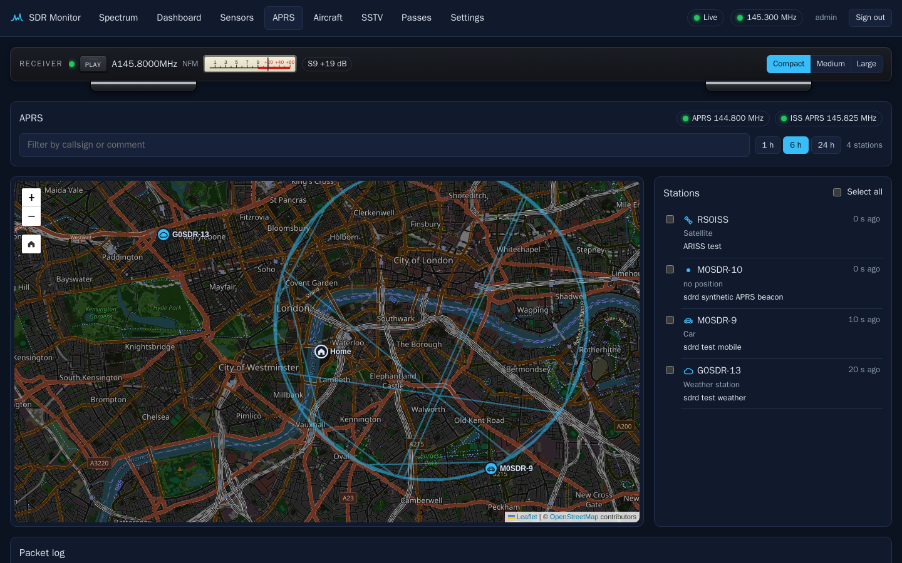
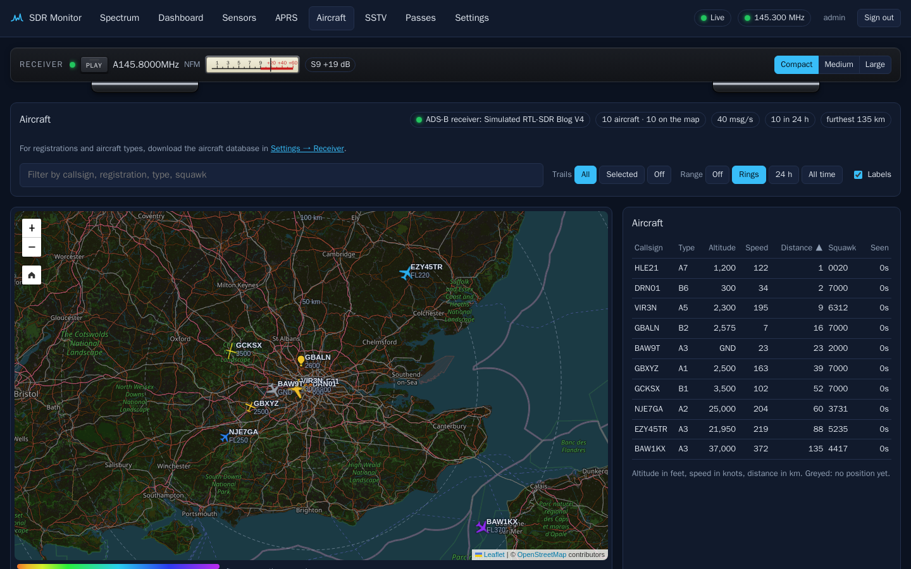
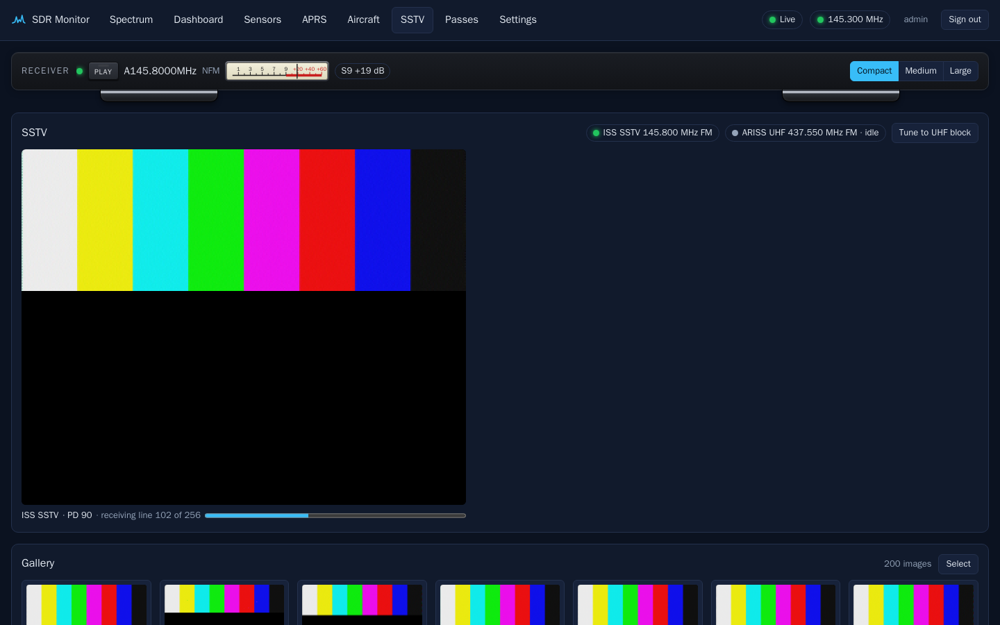
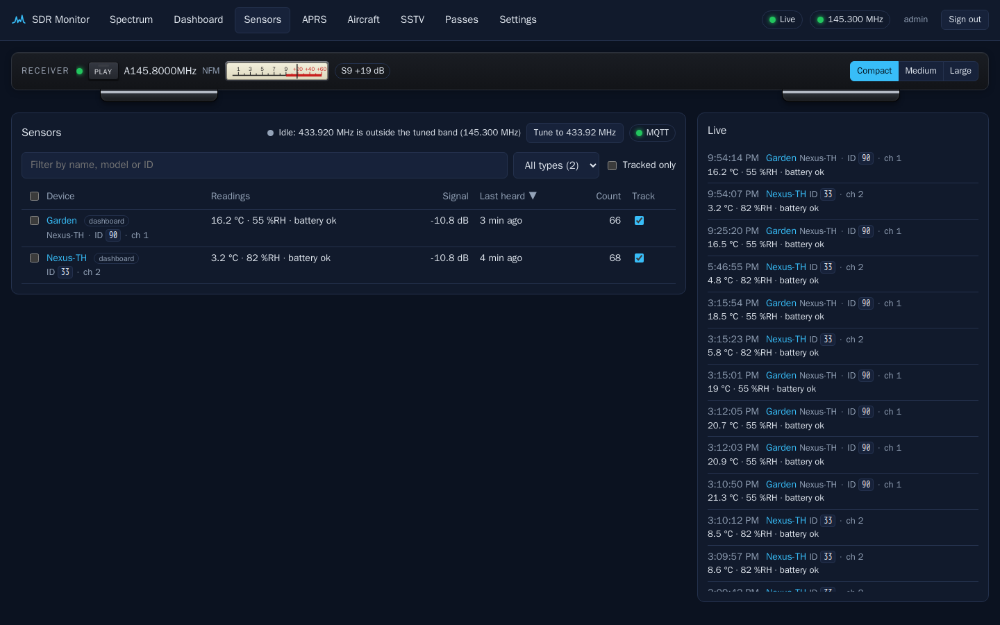
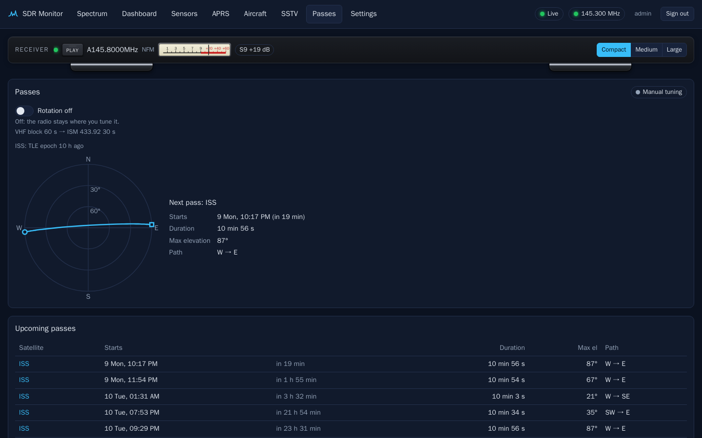
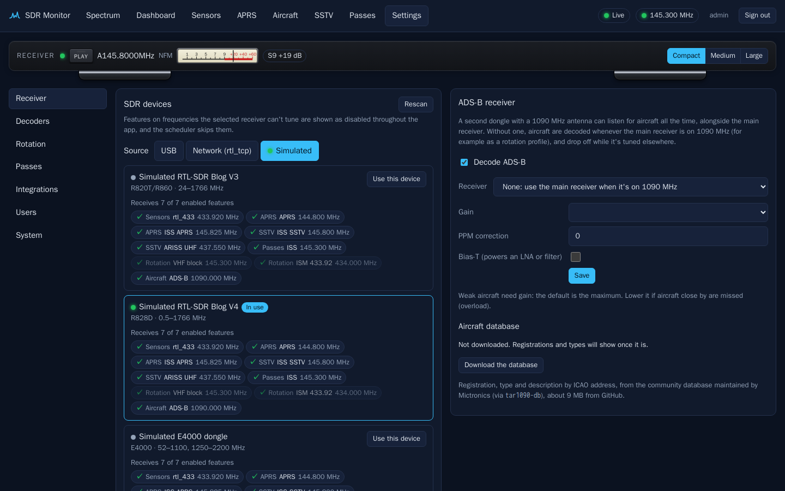
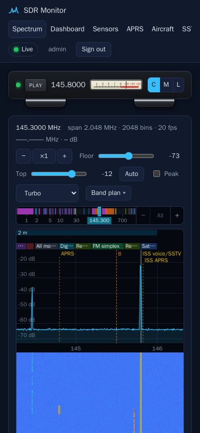
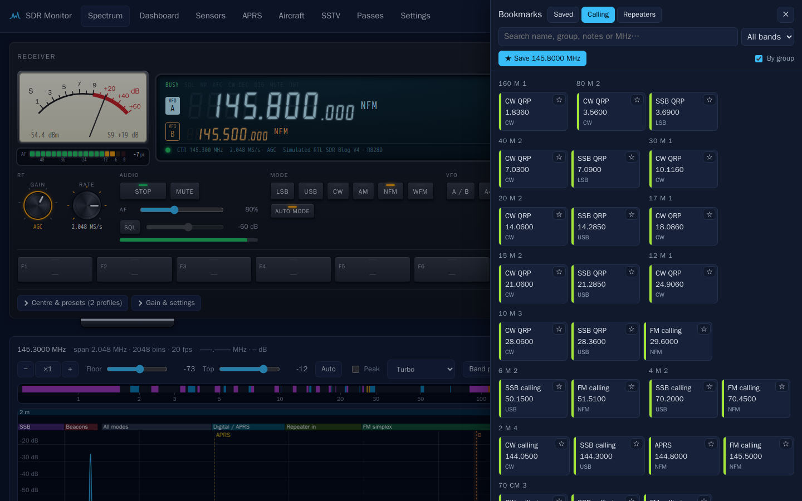

# sdr-web-gui

[](https://github.com/swooningfish/sdr-web-gui/actions/workflows/ci.yml)

A self-hosted, browser-controlled RTL-SDR monitor for a Raspberry Pi, packaged in Docker.
It's inspired by [OnAir](https://github.com/adswill/OnAir) but focuses on unattended
monitoring: TPMS/ISM sensors (rtl_433), APRS, ADS-B and SSTV, including automatic ISS/ARISS
pass recording, with live audio in the browser.

See [SPEC.md](SPEC.md) for the full design and roadmap.



| APRS map | Aircraft (ADS-B) | SSTV |
|---|---|---|
| [](#aprs-direwolf) | [](#aircraft-ads-b) | [](#sstv) |
| **Sensors (rtl_433, TPMS)** | **ISS passes** | **Settings** |
| [](#sensors-rtl_433-tpms) | [](#passes-and-scheduling) | [](#settings) |

All screenshots are of the simulated receiver in the dev stack, so you can see the same thing
without a dongle.

## TL;DR

**Try it on your computer** (no dongle needed, simulated radio):

```bash
cp .env.dev.example .env        # once
docker compose up -d --build    # first start, or after changing code
```

Open <http://localhost:8080> and sign in as `admin` / `devpassword123`.

After that, `docker compose up -d` brings it back up (after a reboot or `docker compose down`),
`docker compose logs -f sdrd` shows the logs, and `docker compose down` stops it.
To use a real USB dongle or open it from other machines, edit `.env` (see
[Development](#development-no-dongle-needed)).

**Run it on a Raspberry Pi 5** with a dongle and HTTPS:

```bash
git clone https://github.com/swooningfish/sdr-web-gui && cd sdr-web-gui
sudo ./scripts/pi-setup.sh
cp .env.example .env && nano .env   # set SDR_DOMAIN and SDRD_ADMIN_PASSWORD
docker compose up -d --build
```

Details in [Deploying on a Raspberry Pi 5](#deploying-on-a-raspberry-pi-5).

## Status: milestone 8 done, milestone 9 next

- [x] Rust core (`sdrd`) owns the dongle via librtlsdr (rtl-sdr-blog fork: V4, V3, generic)
- [x] Live spectrum and waterfall in the browser over WebSocket
- [x] Tuning, gain, sample rate, PPM, bias-T and direct sampling from the UI
- [x] Login with admin and viewer roles, Argon2id, secure sessions, CSRF protection, login rate limiting
- [x] Synthetic and replay IQ sources for development without hardware
- [x] Docker image plus Caddy (automatic HTTPS) compose setup for the Pi
- [x] M2: rtl_433 / TPMS with a flex-decoder editor, sensor history charts, MQTT and Home Assistant
- [x] M3: APRS (Direwolf) with a live map, station tracks, packet log and weather charts
- [x] M4: native SSTV decoder (13 modes, slant correction) with live view and image gallery
- [x] M5: ISS pass prediction (SGP4, CelesTrak TLEs), automatic pass tuning, Doppler tracking, pass recordings, profile rotation
- [x] M6: live audio in the browser (NFM/AM/WFM/USB/LSB, squelch, noise reduction), tabbed settings, profile page, browser layout tests
- [x] Since M6: device selection and tuner coverage, rtl_tcp source, sensor dashboard, multi-select
  delete / ZIP download, sortable sensors, APRS home marker, rotation switch
- [x] M7: spectrum tools: band plans, drag/scroll/keyboard tuning, bookmarks (station list +
  your own, CSV import/export), CW mode and Morse decoder (incl. repeater idents), RDS
- [x] M8: ADS-B aircraft map (second dongle or rotation), type icons, altitude-coloured
  trails, range rings and range stats, aircraft database, Home Assistant sensors
- [ ] M9: signal classifier (voice / data / broadcast labels on the spectrum)

Also still to do: testing on real hardware, a licence. Details in
[SPEC.md](SPEC.md#left-to-do-besides-m7m9).

## Prerequisites

- Docker with the **Compose** and **buildx** plugins. The Dockerfile uses BuildKit cache mounts
  (`RUN --mount=type=cache`) to keep Rust rebuilds fast. Without buildx, Docker falls back to the
  legacy builder and the build fails with `the --mount option requires BuildKit`.

  | Distro | Install buildx |
  |---|---|
  | Arch / Manjaro | `sudo pacman -S docker-buildx` |
  | Fedora / RHEL (Docker CE repo) | `sudo dnf install docker-buildx-plugin` |
  | Fedora (distro `moby-engine`) | `sudo dnf install docker-buildx` |
  | Debian / Ubuntu / Raspberry Pi OS (Docker apt repo) | `sudo apt install docker-buildx-plugin` |

  Check with `docker buildx version`. Docker installed via `get.docker.com` (as
  `scripts/pi-setup.sh` does) already includes it.
- For hot-reload UI work only: Node.js 22+.
- For deployment: an RTL-SDR dongle (RTL-SDR Blog V4/V3 or generic) on a Raspberry Pi 5.

## Development (no dongle needed)

The dev stack is `docker-compose.dev.yml`: sdrd over plain HTTP with a simulated receiver,
plus a throwaway MQTT broker. Copy the dev settings file once so that plain `docker compose`
commands use it, without typing `-f docker-compose.dev.yml` every time:

```bash
cp .env.dev.example .env
docker compose up -d --build
```

Open <http://localhost:8080> and sign in as `admin` / `devpassword123`.

`.env` is not committed, so it's yours to change. The two settings you might change:

| Setting in `.env` | What it does |
|---|---|
| `COMPOSE_FILE=docker-compose.dev.yml` | Simulated receiver only (the default) |
| `COMPOSE_FILE=docker-compose.dev.yml:docker-compose.usb.yml` | Also pass USB dongles into the container (see [Using a real dongle](#using-a-real-dongle-in-development)) |
| `SDRD_DEV_BIND=127.0.0.1` | Only this computer can open the page |
| `SDRD_DEV_BIND=0.0.0.0` | Other machines on your LAN can too, e.g. `http://192.168.0.231:8080`. The dev admin password is public, so anyone on the network can log in and control the dongle: fine on a home LAN, not on a shared one |

After editing `.env`, run `docker compose up -d` to apply it.

> Prefer not to use `.env`? Name the files each time instead:
> `docker compose -f docker-compose.dev.yml -f docker-compose.usb.yml up -d --build`.
> The `SDRD_DEV_BIND=0.0.0.0 docker compose ...` prefix form only works in bash/zsh, not
> PowerShell; putting it in `.env` works in every shell.

### Everyday commands

Run these from the repository folder. With the `.env` above they work the same in dev and
on the Pi.

| To | Run |
|---|---|
| Start, or bring it back up after a reboot / `down` | `docker compose up -d` |
| Start after changing code or `git pull` (rebuilds the image) | `docker compose up -d --build` |
| See whether it's running | `docker compose ps` |
| Follow the logs (Ctrl+C stops following, not the app) | `docker compose logs -f sdrd` |
| Restart sdrd only | `docker compose restart sdrd` |
| Stop | `docker compose down` |
| Stop and **delete all data** (users, events, images, recordings). Dev resets only, never on the Pi | `docker compose down -v` |

`-d` runs it in the background. Leave it off to watch the logs in the terminal; Ctrl+C then
stops the containers. `--build` is only needed when code has changed; without it startup
takes seconds.

### Test signals

The simulated receiver puts test signals on 96.1, 144.470, 144.800, 145.375, 145.7125,
145.800, 145.825, 433.920 and 437.550 MHz (Doppler-drifting carrier). Use the presets to see them.
They are real, decodable transmissions:

- **144.800 / 145.825 (VHF block, the default):** APRS packets that Direwolf decodes: a car
  driving a loop around central London, a weather station, a status beacon, and an "ISS" on
  145.825. Open the APRS tab.
- **145.800 (also in the VHF block):** SSTV test cards cycling through Robot 36, Martin M2,
  Scottie S2 and PD 90, with 20 s gaps. Open the SSTV tab to watch them arrive line by line.
- **433.92 (ISM preset, or *Tune* on the Sensors page):** two Nexus temperature/humidity
  sensors that rtl_433 decodes within ~15 s.
- **144.470 (VHF block):** a CW beacon every 20 s. Listen in **CW** with **Decode CW** on.
- **145.375 (VHF block):** M17 digital voice from GB7SIM every 15 s. Listen in **NFM** with
  **Decode digital** on.
- **145.7125 (VHF block):** a repeater: an over of "speech", then its Morse ident on a 1 kHz
  tone. Listen in **NFM** with **Decode CW** on.
- **96.1 MHz (tune to ~96.25):** an FM broadcast station with RDS ("SIM FM", radio text).
  Listen in **WFM**.
- **1090 MHz:** ten aircraft around London sending ADS-B. Choose a simulated dongle as the
  ADS-B receiver in **Settings → Receiver** (or start with `SDRD_ADSB_DEVICE=sim-v4`), or tune
  the main receiver to 1090 MHz at 2.4 MS/s, and open the **Aircraft** tab. Set the station
  location (Settings → Passes) near London for distances, range rings and the taxiing one.

To watch what sdrd publishes to the dev MQTT broker:

```bash
docker compose exec mqtt mosquitto_sub -v -t 'sdrd/#' -t 'homeassistant/#'
```

### Using a real dongle in development

The receiver is picked in the UI: **Settings → Receiver → SDR devices → Source** switches
between **USB**, **Network (rtl_tcp)** and **Simulated** without a restart, and the choice is
remembered. `SDRD_SOURCE` only sets what's used the first time.

**USB.** The dongle has to be passed into the container, so add `docker-compose.usb.yml`.
In `.env`, comment out the first `COMPOSE_FILE` line and uncomment the second:

```
COMPOSE_FILE=docker-compose.dev.yml:docker-compose.usb.yml
```

then `docker compose up -d`. On Linux that's all (blacklist `dvb_usb_rtl28xxu` first, see
`scripts/pi-setup.sh`). Docker Desktop on **Windows** can't see USB devices until they're
attached to WSL with
[usbipd-win](https://github.com/dorssel/usbipd-win). In an admin PowerShell, once:

```powershell
winget install usbipd
usbipd list                   # note the BUSID of the 0bda:2838 device
usbipd bind --busid <BUSID>
```

then after each replug or reboot, before starting the containers:

```powershell
usbipd attach --wsl --busid <BUSID>
```

While attached, Windows programs (SDR#, SDR++) can't use the dongle; `usbipd detach --busid <BUSID>`
gives it back. Docker Desktop on macOS can't pass USB through at all: use rtl_tcp.

**rtl_tcp (any OS).** Run `rtl_tcp -a 0.0.0.0` on the machine with the dongle (it comes with
the rtl-sdr tools; Windows builds are on the RTL-SDR Blog releases page). Then choose
**Source: Network (rtl_tcp)** and connect to `host.docker.internal:1234` for the computer
running Docker, or the machine's IP address. It's unencrypted and unauthenticated, so keep it
on your LAN.

### UI work with hot reload

Keep the dev stack running, then:

```bash
cd web && npm install && npm run dev
```

and open the address Vite prints. Vite proxies `/api` to `localhost:8080`, so UI changes
show up instantly without rebuilding the image.

### Tests

Unit tests (DSP, decoders, SSTV encode → decode, ADS-B, auth, …) and the UI type check need
no running stack:

```bash
cargo test                          # needs Rust; or in Docker, see below
cd web && npm ci && npm run check   # svelte-check
```

No Rust installed? Run the Rust tests in the official image instead:
`docker run --rm -v "${PWD}:/src" -w /src rust:1-bookworm cargo test` (bash or PowerShell).

With the dev stack running:

- `./scripts/smoke-test.sh` checks the API: health, login, auth and CSRF rules, and each
  feature's endpoints.
- `./scripts/ui-test.sh` runs Playwright (in its official Docker image, nothing to install) at
  1920, 1366, 820 and 375 px wide. It checks that no page scrolls sideways and exercises the
  receiver front panel, spectrum zoom and tuning, bookmarks and F-keys, settings tabs, maps,
  lists and galleries. Pass Playwright options through, e.g.
  `./scripts/ui-test.sh --project=phone-375`. Some tests only run at one width, or skip
  themselves when the stack can't support them (e.g. no ADS-B receiver), so a run shows some
  as skipped.
- `./scripts/screenshots.sh` regenerates the screenshots in this README
  (`docs/screenshots/`). It borrows a simulated ADS-B receiver for the Aircraft shot and puts
  your setting back afterwards.

These are bash scripts: on Windows run them from Git Bash or WSL.

**Continuous integration.** [GitHub Actions](.github/workflows/ci.yml) runs all of the above
on every push to `main` and every pull request: `cargo test`, `svelte-check` and the
production UI build, then it builds the Docker image, starts the dev stack and runs the
smoke and Playwright tests against it. The badge at the top shows the result for `main`;
click it for the logs. A run can also be started by hand from the repository's **Actions**
tab (**CI → Run workflow**).

## Deploying on a Raspberry Pi 5

```bash
git clone https://github.com/swooningfish/sdr-web-gui && cd sdr-web-gui
sudo ./scripts/pi-setup.sh          # blacklist DVB driver, udev rule, Docker
cp .env.example .env && nano .env    # SDR_DOMAIN, SDRD_ADMIN_PASSWORD, ...
docker compose up -d --build         # first build takes a while on the Pi
docker compose logs -f sdrd
```

Use `.env.example` here, not `.env.dev.example`: without `COMPOSE_FILE`, `docker compose`
uses the production `docker-compose.yml`. Caddy obtains a Let's Encrypt certificate for
`SDR_DOMAIN`. Point DNS at your public IP and forward ports 80 and 443 to the Pi. sdrd itself
is only reachable through Caddy. The containers restart on their own after a reboot.

To update later:

```bash
git pull && docker compose up -d --build
```

The [everyday commands](#everyday-commands) work the same on the Pi.

## Sensors (rtl_433, TPMS)

rtl_433 runs inside the container and is fed from sdrd's own IQ stream: sdrd cuts ~256 kHz
around the rtl_433 frequency (433.92 MHz by default) out of whatever the dongle is tuned to.
So it decodes whenever 433.92 MHz is inside the tuned band. With one dongle that means the ISM
preset, or the ISM step of **rotation** (see [Passes and scheduling](#passes-and-scheduling)).

- **Sensors** tab: every device heard, latest readings, signal, a live feed, and per-device
  history with charts (1 h / 24 h / 7 days). Repeats of the same transmission are merged.
- **Settings → ISM decoder**: enable/disable, frequency, `-R` protocol list, and flex decoders
  (`-X`). *Check* asks rtl_433 itself whether it accepts a spec; saving restarts rtl_433.
  TPMS sensors are decoded by rtl_433's built-in decoders (Schrader, Toyota, Ford, Renault,
  Hyundai, BMW and more) and show up under their make with pressure and temperature. A flex
  decoder only reports raw bits, so add one only to explore an unknown signal, and give it a
  `match=` or `preamble=` so it doesn't fire on every burst.
- **Track** a device to keep it beyond the retention period and publish it to Home Assistant.
- Viewers can't see sensor data unless `SDRD_ISM_VIEWERS=true` (it's other people's TPMS IDs).

## APRS (Direwolf)

Each APRS channel (default 144.800 MHz and ISS APRS 145.825 MHz) is cut out of the capture
as a 16 kHz slice, FM-demodulated and piped to its own Direwolf process; decoded frames come
back over KISS. The default VHF block (145.3 MHz at 2.048 MS/s) covers both channels at once,
alongside ISS SSTV on 145.800.

- **APRS** tab: live map (OpenStreetMap) with station labels and tracks, station list,
  per-station details (position, speed/course, altitude, comment, raw packets, weather charts
  for weather stations) and a packet log. 1 h / 6 h / 24 h window.
- Parses uncompressed and compressed positions, Mic-E, objects, items, status, messages
  and weather reports. Copies of a packet repeated by digipeaters are merged.
- **Settings → APRS decoder**: up to 4 channels with labels.
- APRS is public amateur traffic, so viewer accounts can see it.
- The map uses OpenStreetMap's tile server. Set `SDRD_MAP_TILE_URL` to use another one (the
  Content-Security-Policy follows it).

## Aircraft (ADS-B)

sdrd decodes ADS-B and Mode S on 1090 MHz itself (no readsb needed), from either:

- **A second dongle** (best): pick it under **Settings → Receiver → ADS-B receiver**. It stays
  on 1090 MHz at 2.4 MS/s with its own gain (maximum by default), PPM and bias-T, alongside
  the main receiver, which keeps doing everything else. A dongle can't be used by both.
- **The main receiver**, whenever it's tuned to 1090 MHz with 2 MS/s or more: tune there, or
  add an *ADS-B 1090* rotation profile (the Aircraft tab offers both). Aircraft drop off
  while it's tuned elsewhere.

The **Aircraft** tab shows a live map with an icon per aircraft type (from the category the
aircraft broadcasts), rotated to its track and coloured by altitude, with trails in the same
colours and a legend; range rings every 50 km from the station; and the furthest range per
direction over 24 hours or all time, which shows where the antenna sees well and what blocks
it. The list sorts by any column and filters by callsign, registration, type or squawk;
emergencies come first, in red. Click an aircraft for its details.

For registrations and types, an admin downloads the **aircraft database** (Mictronics, via
tar1090-db, ~9 MB from GitHub) under Settings → Receiver. Distances and range need the station
location (Settings → Passes).

## SSTV

A native Rust decoder (no external program). Each SSTV channel is filtered out of the
capture, demodulated (FM, or USB/LSB for HF), and turned into a tone-frequency track. The
VIS header picks the mode automatically:

- Robot 36 and 72
- Martin M1 and M2
- Scottie S1, S2 and DX
- PD 50, 90, 120, 160, 180 and 240

Every line's sync pulse is tracked, so slant from clock differences is corrected.

- Default channels: **ISS SSTV 145.800 MHz** (in the default VHF block) and **ARISS UHF
  437.550 MHz**, both FM. Up to 4 channels under Settings → SSTV decoder.
- When a channel isn't being listened to, the SSTV tab offers admins **Tune to VHF block**
  (145.3 MHz) or **Tune to UHF block** (437.0 MHz, covering 436.1–437.9 MHz), whichever
  holds that channel.
- **SSTV** tab: images appear line by line as they are received, then go into the gallery
  with thumbnails, a full-size viewer, download and (admins) delete.
- If the signal fades or the radio is retuned mid-image, whatever was received is still
  saved, marked as partial, as long as at least a fifth of the image came through.
- Images are PNG files in `/data/sstv` and are **not** removed by the event retention period.
- SSTV is public amateur traffic, so viewer accounts can see it.
- During ISS passes, channels marked **Doppler** follow the satellite's Doppler shift
  (±3.5 kHz at 145.8 MHz, ±10 kHz at 437.55 MHz).

## Live audio

Press **Play** on the receiver's front panel, then click the waterfall, turn the tuning knob or
click the big frequency on the display to type one, to listen anywhere inside the tuned band.
The channel is shaded on the spectrum.

- Modes: **NFM**, **AM**, **WFM** (broadcast, 50 µs de-emphasis, RDS), **USB**, **LSB**,
  **CW** (a carrier on the dial frequency is heard as a 700 Hz note).
- **CW dec** shows Morse as text under the spectrum (5–40 WPM, speed found
  automatically). It also reads the Morse ident an FM repeater sends after an over (NFM).
- **Digital** (NFM) identifies and decodes digital voice: DMR, D-STAR, System Fusion
  (YSF), NXDN, P25, dPMR and M17, detected automatically. The strip under the spectrum shows who is on air
  (callsign or radio ID, talkgroup or destination, colour code / NAC / RAN / CAN, talker alias
  and text messages), a log of recent calls, and optionally DSD-neo's console. It uses
  [DSD-neo](https://github.com/arancormonk/dsd-neo), one process per listener, fed the raw FM
  discriminator. Decoded voice is not played (the AMBE/IMBE vocoders are patent-encumbered);
  you hear the FM audio as usual.
- **RDS:** in WFM the strip under the spectrum shows the station name, programme type and radio text.
- **Squelch**, **noise reduction** (spectral; removes steady hiss), **volume** and **mute**.
  Settings are remembered per browser; clicks snap to the mode's channel raster.
- Audio is demodulated per listener in sdrd and streamed over the existing WebSocket as
  IMA ADPCM (about 70 kb/s for voice modes), played through an AudioWorklet with a
  250 ms jitter buffer. No codec libraries are needed on the Pi.
- Up to 4 listeners at once (`SDRD_AUDIO_MAX_LISTENERS`); admins only unless
  `SDRD_AUDIO_VIEWERS=true`.

## Spectrum tools



Everything works on a phone or tablet too: the tab bar scrolls, the front panel folds to
one line (**Compact**), and you drag and pinch-zoom the spectrum with your fingers.

- **Band plan:** the strip above the spectrum shows UK amateur bands with their RSGB
  sub-bands, plus broadcast, aviation, marine, CB/PMR446, ISM/SRD and satellite bands.
  Choose groups under **Band plan**; hover to name the band. With **Auto mode** on the
  front panel, clicking airband picks AM, broadcast FM picks WFM, and so on.
- **Moving along the band (admins):** drag the spectrum, swipe sideways on a trackpad,
  scroll the mouse wheel once the spectrum has focus (click it first), or use the
  Left/Right arrow keys (Shift for bigger steps). Up/Down step the listening frequency.
  Double-click centres on a signal.
- **Zoom:** the **− ×1 +** buttons, Ctrl + mouse wheel or a trackpad/touch pinch (about
  the cursor), or the + and − keys; the middle button (or 0) goes back to ×1. Zoomed in
  (up to ×64) you see part of the sampled band and can pan within it; panning past its
  edge retunes the radio (admins). Zoomed out (to about 65–100 MHz across) you see the
  band plan beyond what the radio samples: the sampled band is outlined, the rest is
  hatched *not sampled*. Admins drag the outline to retune, or use **Widen** to pick the
  highest sample rate. Clicking outside the outline to listen also retunes.
- **Mini map:** the strip above the spectrum covers the receiver's whole range (log
  scale, e.g. 24–1766 MHz) with the band plan in colour, bookmarks, the listening
  frequency, the sampled band (labelled with its frequency) and the zoomed-out view.
  Hover to name a frequency; click, drag or use the arrow keys to move the radio there
  (admins). **−** / **+** at its right end zoom the map (Ctrl + wheel or pinch zoom about
  the cursor), down to a few MHz across; zoomed in, drag the map to pan (drag the cyan
  marker to move the radio) and click the level (e.g. **×8**) to fit the whole range
  again. An arrow at the edge points to the radio when it's off the part shown. Hide it
  under **Band plan**.
- **Receiver front panel:** at the top of every page, laid out like a transceiver. The
  display shows **VFO A** and **VFO B** (the one you hear is the big one), annunciators
  (BUSY when the squelch is open, SQL, NR, AFC, CW-DEC, DIG with the sync found, MUTE, OUT
  when the channel is outside the sampled band) and the centre frequency, rate, gain and
  device. Beside it are an analogue **S-meter** for the channel you're listening to (read
  from the spectrum, so it works without audio; dBm is estimated from the gain, with a
  per-browser trim and an optional IARU VHF scale under *Gain & settings*), with an
  **audio meter** under it (what you hear, after the volume: LED segments for the level and
  a peak-hold segment, −54 to 0 dBFS), and the **tuning knob**: drag it round, scroll over
  it, or focus it and use the arrow keys (Page Up/Down for ten steps), with the **step**
  below it. Click the big frequency to type one. Keys below: the **RF** knobs, **Play/Stop**,
  **Mute**, AF volume, squelch; the mode keys and **Auto mode**; **A / B** swaps which VFO
  you hear and **A=B** copies it to the other (VFO B is a dashed orange marker on the
  spectrum); **NR**, **AFC**, **CW dec** and **Digital**. **Centre & presets** (centre
  frequency and nudges, presets, rotation profiles and the rotation switch) and **Gain &
  settings** fold out below.
- **RF knobs (admins):** **Gain** pushes in for AGC (a click, or Enter, with the ring lit);
  pulled out, turn it (drag up/right, scroll or arrow keys) through the dongle's gain steps.
  It comes out at the last manual gain. **Rate** turns through the sample rates. Both apply
  once the knob stops, so turning past several values retunes once.
- **Sizes:** **Compact** is one line (Play, the frequency, a bar meter), **Medium** the
  display, meters, tuning knob and function keys, **Large** the whole panel. Each browser
  remembers the size and what's open.
- **Function keys F1–F8:** each recalls a frequency and mode, usually a bookmark. Click an
  empty key to pick a bookmark for it; right-click (or long-press on a touch screen) a key,
  or turn on **F-Set** and click it, to pick another, store what you're hearing, or clear
  it. Keys are saved per user on the server, so they follow you to any browser. A key keeps
  its own copy, so it still works if its bookmark is deleted; while the bookmark exists the
  key follows its edits. The lit key is the one you're on.
- **Bookmarks:** flags above the spectrum, and a manager that slides out from the right
  (**Bookmarks** on the front panel; Escape closes it). Bookmarks are tiles, grouped by
  group (or band, or repeater mode); click one to listen (admins also retune if it's
  outside the band). **★ Save** keeps the current frequency. The **station list** is shared
  with everyone (admins edit it); **mine** are yours alone. **Calling** lists standard
  calling frequencies (IARU Region 1 / UK band plans) and **Repeaters** lists repeaters near
  the station from RepeaterBook (see [Settings](#settings)); ☆ saves one as a bookmark.
  **Manage**: click tiles to select several and delete them, ✎ to edit, **F** to put one
  on a function key, and export CSV or import a CSV (our own export, CHIRP or gqrx
  `bookmarks.csv`).

  
- **Harmonics check (admins):** click a short-range device's signal (a key fob, sensor or
  telemetry link) so you're listening to it, then **Check harmonics** under the spectrum.
  It measures the carrier, retunes to the 2nd–5th harmonics (as far as the dongle reaches),
  watches each for a few seconds and rates each one **Good**, **Medium** or **Bad** against
  **Ofcom** (UK SRD bands, ETSI EN 300 220-1 spurious limits) and **FCC** Part 15
  (§15.231, §15.249, §15.227, with §15.205 restricted bands), saying which limit fails and
  by how much. Limits assume the carrier is at the legal maximum unless you say it runs
  lower. It's a pre-compliance indicator: the dongle isn't calibrated, so *Good* needs a
  6 dB margin. Use a fixed gain, keep the device transmitting, and switch rotation off
  first. It also lists **spurs near the carrier** (sidebands, clock or regulator combs)
  from the same capture, without retuning: each is rated against the EN 300 220-1
  out-of-band mask (within 2.5 channel widths) or spurious limit beyond, and FCC
  §15.231(b); spurs still there when the device stops are marked as someone else's, and
  an evenly spaced comb is called out. The simulator has an SRD on 434.2 MHz with
  harmonics and a 50 kHz spur comb to try it on.

## Settings

Admins get **Settings**, split into tabs: Receiver (SDR devices), Decoders (rtl_433, APRS,
SSTV), Rotation (profiles), Passes (location, satellites, auto-switch, TLEs, test pass),
Integrations (MQTT / Home Assistant, RepeaterBook), Users and System (read-only server
settings). Everyone manages their bookmarks and function keys from the receiver.

**RepeaterBook** (Integrations) fills *Bookmarks → Repeaters* with repeaters within a radius
(default 1 mile) of the station location. RepeaterBook only serves approved clients:
request API access at repeaterbook.com, then enter the token and a contact email (it goes
in the User-Agent, as RepeaterBook requires). The token stays on the server. The country
list is fetched at most once a day and only repeaters inside the radius are kept. Their
terms allow personal use; check them before sharing the station more widely. Everyone can open their
**profile** from their username in the header to change their password or sign out.

## Passes and scheduling

Set the station location under **Settings → Passes**: search for a town or postcode, type a
Maidenhead locator (e.g. `IO91wm`), enter coordinates, or press *Use this device's location*
(browsers only allow that over HTTPS or on `localhost`, not on a plain-HTTP LAN address).
sdrd then predicts passes for 48 hours ahead with SGP4. Orbit data (TLE) comes
from CelesTrak and is refreshed every 12 h; it can also be pasted in by hand for offline
setups. Predictions were cross-checked against skyfield: AOS/LOS within a second, look
angles and range-rate matching to 0.001.

During a pass of an enabled satellite (ISS by default, above 10°):

0. With **auto-switch** on (Settings → Passes, the default), a notice under the receiver
   counts down to the pass (from 2 min before tuning). Admins can press **Stay** to keep
   the current tuning for that pass; anyone can **Keep this page**. Otherwise it switches
   on its own, and every open page jumps to Passes when the pass starts. With auto-switch
   off, passes are only predicted and shown.
1. From 30 s before AOS the radio is tuned to the satellite's profile (default the VHF
   block, which covers ISS SSTV 145.800 and ISS APRS 145.825).
2. The Doppler shift is published to the decoders, so channels marked *Doppler* track it.
3. The downlink (default 145.800 MHz FM) is recorded to WAV, Doppler-corrected, in
   `/data/passes`. Recordings are kept until deleted.
4. At LOS the previous tuning is restored, or rotation carries on.

The **Passes** tab has:

- a live sky plot with azimuth, elevation, range and Doppler during a pass
- the next passes with their tracks
- recordings with an audio player, plus any SSTV images received during each pass

For ARISS events on 437.550 MHz, change the ISS tune and recording frequencies to 437.6 and
437.550 MHz.

**Rotation** (off by default) cycles through profiles when no pass is on, for example VHF
block 60 s then ISM 30 s. It never hops away while an SSTV image is coming in (up to 5 min).
Admins switch it on or off with the **Rotation** switch under the receiver's presets or on
the Passes tab (or `PUT /api/schedule/rotation {"enabled": true}`); profiles are edited in
Settings → Rotation and show as quick-tune buttons under the receiver's presets.
Admins can run a **test pass** to check tuning and recording end to end. A pass in progress
(real or test) can be stopped from the Passes tab or Settings.

## MQTT / Home Assistant

Set `SDRD_MQTT_HOST` (and user/password if needed) in `.env`. sdrd publishes:

| Topic | Content |
|---|---|
| `sdrd/status` | `online` / `offline` (retained, last will) |
| `sdrd/events/rtl_433`, `…/aprs`, `…/sstv` | every decoded event as JSON (turn off with `SDRD_MQTT_EVENTS=false`) |
| `sdrd/devices/<device>/state` | latest data of tracked devices (retained) |
| `homeassistant/sensor/…/config` | HA discovery for tracked devices: temperature, humidity, pressure, battery, signal, … |
| `homeassistant/device_tracker/…/config` | HA device tracker for tracked APRS stations (shows them on the HA map) |
| `sdrd/adsb/state` | ADS-B: aircraft count, with position, messages/s, furthest, closest (retained, every 30 s) |
| `homeassistant/sensor/sdrd_adsb_…/config` | HA discovery for the ADS-B sensors (once there's ADS-B to report) |

Only tracked devices create Home Assistant entities, so passing cars don't flood HA.
Discovery is re-sent when Home Assistant restarts.

### User management from the shell

```bash
docker compose exec -T sdrd sdrd user add alice viewer <<< 'a-long-password'
docker compose exec -T sdrd sdrd user passwd admin <<< 'new-long-password'
```

## Configuration

All settings are `SDRD_*` environment variables. See [.env.example](.env.example). Notable ones:

| Variable | Default | Meaning |
|---|---|---|
| `SDRD_SOURCE` | `rtlsdr` | Receiver to start with if none was chosen in the UI: `rtlsdr`, `rtl_tcp`, `synthetic`, or `replay` (with `SDRD_REPLAY_FILE=/data/x.cu8`) |
| `SDRD_RTLTCP` | – | `host:port` of an rtl_tcp server to list under Source: Network (required for `SDRD_SOURCE=rtl_tcp`) |
| `SDRD_ADSB_DEVICE` | `off` | ADS-B receiver if none was chosen in the UI: a device id (`sn:…`, `idx:1`, `tcp:host:port`, `sim-v4`) or `off` |
| `SDRD_CENTER_HZ` | `145300000` | Startup centre frequency |
| `SDRD_SAMPLE_RATE` | `2048000` | Startup sample rate |
| `SDRD_GAIN` | `auto` | `auto` or dB |
| `SDRD_FFT_SIZE` / `SDRD_FPS` | `2048` / `20` | Waterfall resolution and rate |
| `SDRD_COOKIE_SECURE` | `true` | Must stay `true` when served over HTTPS |
| `SDRD_TRUST_PROXY` | `false` | Trust `X-Forwarded-*` headers (set by compose behind Caddy) |
| `SDRD_MQTT_HOST` | (off) | MQTT broker; also `_PORT`, `_USER`, `_PASSWORD`, `_PREFIX`, `_DISCOVERY_PREFIX` |
| `SDRD_EVENT_RETENTION_DAYS` | `30` | Delete older events and untracked devices |
| `SDRD_ISM_VIEWERS` | `false` | Let viewer accounts see sensors / TPMS |
| `SDRD_AUDIO_MAX_LISTENERS` | `4` | Concurrent live-audio listeners (0 turns live audio off) |
| `SDRD_AUDIO_VIEWERS` | `false` | Let viewer accounts listen to live audio |
| `SDRD_MAP_TILE_URL` | OpenStreetMap | Map tile URL template with `{z}`, `{x}`, `{y}` (and optional `{s}`) |

## Architecture

```
RTL-SDR ─USB─► radio thread (librtlsdr) ─► IQ broadcast ─┬► waterfall FFT ─────────────────► WebSocket ─► browser
                    ▲ retune                              ├► DDC 433.92 → rtl_433 ──────────┐
               REST /api/radio  ◄── admin UI             ├► DDC 144.800 → FM → Direwolf ───┼► events ─► SQLite, WebSocket, MQTT
                                                          ├► DDC 145.825 → FM → Direwolf ───┤
                                                          ├► DDC 145.800 → FM → SSTV ───────┘─► PNG in /data/sstv
                                                          │      (tone demod, VIS, sync tracking)   + live rows ─► WebSocket
                                                          └► recorder (FM, Doppler) ─► WAV in /data/passes
  scheduler ── TLE (CelesTrak) + SGP4 ─► passes ─► retune radio, Doppler ─► decoders/recorder

2nd RTL-SDR ─► radio thread (1090 MHz) ─► Mode S demod ─┐
main IQ when on 1090 MHz ─────────────► Mode S demod ─┴► aircraft tracker ─► REST /api/adsb, MQTT, sightings log
```

- `crates/sdrd`: Rust daemon (axum, tokio, rustfft, sqlx/SQLite)
- `web`: Svelte 5 + Vite single-page app

## Legal note

Receiving amateur radio (APRS, ISS SSTV) is fine to share. In the UK the Wireless Telegraphy
Act restricts disclosing the content of other transmissions you weren't meant to receive.
TPMS and ISM data from other people's devices falls under this. Keep those views to trusted
users if the site is public.
